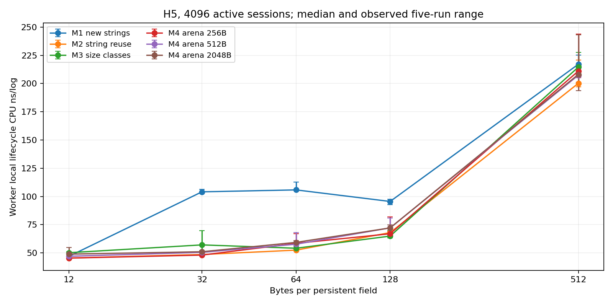
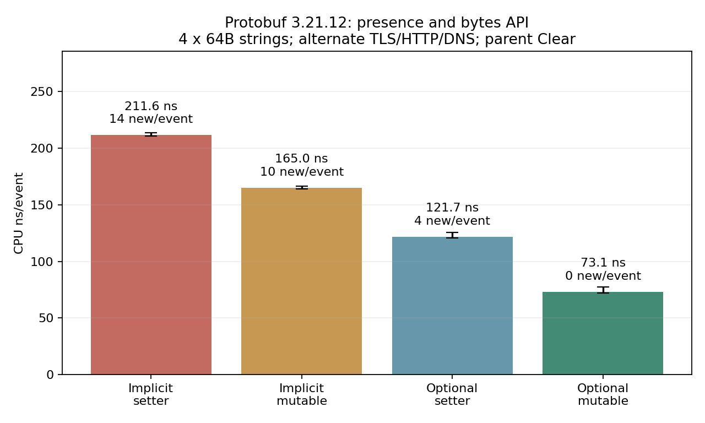

# 有状态通信架构：存储、六种槽位、生命周期与Protobuf组织实测

用户参考中的S1～S6格式比较已有证据，本轮保留索引；新增M1～M4、H1～H6、L1～L3、P1/P2及模块扩展性。**142个pipeline配置、1980条隔离CPU样本、710条双CPU样本、660条proto时间、660条proto分配审计、30条存储审计、90条分配器扩展性记录**。所有数字来自实际执行，非模型预测。

第一版隐式子消息/旧setter的完整142配置数据没有删除，见[基线说明](baseline_implicit/README.md)。本轮发现并修正两项隐藏成本：[3.21.12生成代码与API核查](PROTOBUF_3_21_NOTES.zh-CN.md)。

## 用结果选默认组合

先固定PB后端的对象与容量复用，再比较交接。相同64B字段、逐条协议切换、父Clear的同二进制交叉实测：

| 字段存在性 | 官方bytes写入API | 编码ns/event | C++ new/event |
|---|---|---|---|
| P0_implicit_parent_clear | set_ptr_len | 211.60 | 14.00 |
| P0_implicit_parent_clear | mutable_assign | 165.05 | 10.00 |
| P2_explicit_parent_clear | set_ptr_len | 121.73 | 4.00 |
| P2_explicit_parent_clear | mutable_assign | 73.05 | 0.00 |

最终显式optional＋mutable assign约为73.05ns，隐式＋旧setter约211.60ns；不能把这两项隐藏成本归因于SPSC或存储池。mutable assign仍复制字节，零分配不等于零拷贝。

优先评估M2字符串池化复用作为存储基线；本轮没有证据支持“自定义arena必然更快”。H5模块快照在完整字段的前台组装较轻，H2/H3在稀疏字段更省动作；H4整块复制可以让发日志动作变快，却不自动让包括状态更新的完整会话路径更快。H6只写指针需要源已冻结，变化源的四版本成本已另计。L1/L2/L3要按所有权、丢弃控制和池预算选择，不能用“没有额外原子计数”直接推导L3稳定更快。

**吞吐暂不用于给出唯一赢家或生产容量承诺。** 主矩阵部分配置出现很大的高吞吐簇；独立进程交错复查中有些中位数明显回落。已保留全部数据，不挑最高值：

| 方案 | 规则/生命周期 | Logger CPU | 主矩阵Mlog/s中位 | 独立进程交错复查Mlog/s（范围） |
|---|---|---|---|---|
| H1_deep | workflow_dense/L0_owned | 1 | 1.62 | 1.67（1.61–1.72） |
| H1_deep | sparse/L0_owned | 1 | 1.96 | 1.95（1.92–2.47） |
| H2_tape | workflow_dense/L3_piggyback | 1 | 7.47 | 1.86（1.76–1.91） |
| H2_tape | sparse/L3_piggyback | 1 | 2.00 | 2.00（1.99–2.09） |
| H3_selective | workflow_dense/L3_piggyback | 1 | 1.83 | 1.80（1.70–1.83） |
| H3_selective | sparse/L3_piggyback | 1 | 2.15 | 1.91（1.85–10.45） |
| H4_bulk | workflow_dense/L3_piggyback | 1 | 1.25 | 1.15（1.11–1.20） |
| H4_bulk | sparse/L3_piggyback | 1 | 5.75 | 1.41（1.35–1.49） |
| H4_bulk | sparse/L3_piggyback | 2 | 1.43 | 2.12（1.33–7.93） |
| H5_modules_copy | workflow_dense/L3_piggyback | 1 | 1.47 | 1.46（1.34–2.01） |
| H5_modules_copy | workflow_dense/L3_piggyback/extra_zero | 1 | 1.55 | 1.49（1.38–1.67） |
| H5_modules_copy | workflow_dense/L3_piggyback | 2 | 1.44 | 2.58（1.36–5.31） |
| H5_modules_copy | sparse/L3_piggyback | 1 | 9.34 | 1.53（1.51–2.77） |
| H6_versioned_ptr | workflow_dense/L3_piggyback | 1 | 1.42 | 1.38（1.33–1.41） |
| H6_versioned_ptr | sparse/L3_piggyback | 1 | 1.51 | 1.50（1.45–2.63） |

22个配置、5次外层随机交错，共110条，均为新启动进程内至少300ms样本；追加复查的节流计数合计0。例如H5稀疏主矩阵的高吞吐不能直接当作稳定优势。没有足够硬件计数来定位这些吞吐状态，不能武断归因于预取、原子操作或虚拟核心关系；隔离CPU成本与正确性结论可独立评估。

## 不同字段跨大小级的补测

原主矩阵各字段在同档长度相同。补充六个常驻字段分别12/32/64/128/256/512B，共1004B，使slab真实跨多个大小级。固定H5、单CPU、4096活跃Session，完整字段在计时外核对122,880次；本补测没有双CPU吞吐：

| 混合长度存储 | Worker本地生命周期 ns/log | Logger ns/log | 完整载荷B | 槽/块/string容量B |
|---|---|---|---|---|
| M1_string_new | 158.33（140.15–159.94） | 160.78（156.11–178.90） | 1004 | 1007 |
| M2_string_reuse | 102.11（90.91–142.21） | 162.21（155.91–164.48） | 1004 | 1007 |
| M3_slab | 95.04（94.54–99.06） | 150.38（148.40–152.55） | 1004 | 1024 |
| M4_arena256 | 98.54（98.26–99.34） | 149.90（149.28–156.28） | 1004 | 1024 |
| M4_arena512 | 94.83（94.18–108.83） | 152.90（151.56–156.28） | 1004 | 1024 |
| M4_arena2048 | 101.58（98.70–108.60） | 163.40（161.67–188.70） | 1004 | 2048 |

容量包含inline SSO或池块有效容量，元数据另计。它不包括所有分配器元数据；池页总量按4096个Session预留，不能直接与主矩阵8193对象预算比较。混合分布依然不能证明某种硬件预取因果。

## 原始记录与修正的界线

原泛型proto fixture的mixed分支重复刷新了TLS；其660行原始文件不删除。最终proto摘要的单detail540行仍来自主文件，mixed120行改用每个detail只填一次的独立补测；该补测另做120行分配审计及每条件64次wire一致核对。规范分析输入保存在[proto_canonical.csv](results/proto_canonical.csv)，source_sample_file列明确出处。

核心pipeline每个case均记录资源增量，新增节流合计0次。后续阶段定位为：proto_bench新增0次/0微秒；proto_alloc新增0次/0微秒；store_audit新增0次/0微秒；allocator_scaling新增39次/67198微秒。4线程分配器扩展性阶段的小额节流不应被默认为所有双CPU样本的状态。

## 先回答哪些想法成立

1. H6直接指向会变化的会话导出结构不是日志快照。单线程可重现：发出时值1926，随后更新，指针读到2935，而H5快照保持1926。主测H6使用每会话四阶段不可变版本，版本构造和内存都计入；另列源本来就冻结时的描述符成本。[反例](validation/consistency.json)
2. H5复制string_view也没有复制其字节。已实际验证原数据随后修改时，浅快照跟着变化，深拷贝保持旧值。本轮借用模式要求会话字符串写入后不再改变；真实多请求URL/重写字段需版本或深拷贝。[语义验证](validation/semantics.json)
3. `oneof`无法同时保留TLS与HTTP。P1/P2只在每条一个detail时作等信息比较；2313条fixture逐字节一致；P2混合日志另列，不用P1丢弃一半信息来制造更低耗时；最终mixed计时采用每个子消息只填一次的补测。
4. 结构体整块复制、按需填、模块快照的排名随字段数和布局变化。默认M2/64B字段中，完整规则下最小组装中位数为H5_modules_copy的21.72ns；四字段规则下为H2_tape的14.61ns。它们包括公共元数据和临时字段，不是单条CPU store耗时，也不是整个流水线的最佳排名。
5. L3没有被当作无需维护的“魔法回收”：包含尾部排空、停机扫描、无接受记录、最后一条被丢弃的处理。ASan/UBSan模式尝试30,000,000条，实际消费并完整核对21,796,374条，字段错误0；这是有限执行证据，不是100%安全的形式化证明。

## 统一工作负载与口径

GCC14.2/O3/C++20/march=native，官方Protobuf3.21.12；AMD EPYC9V74/KVM，5逻辑CPU可见，cgroup4CPU。主表使用显式optional子消息与mutable assign复用官方PB；主测CPU0/1，另10组CPU0/2；不能称为独占物理双核。

4096个活跃会话位置，四阶段轮转：TLS提取与日志→HTTP提取与完整日志→四字段风险日志→汇总日志后立即关闭。主三模块共12常驻字段，完整HTTP另加32B一次性XFF；标准完整阶段规则四条日志字段数分别6/13/4/4。每字段12/32/64/128/512B，另测15/16/48B；本轮256/512/2048B指arena块尺寸，不是消息大小。

归一化schema每模块最多2标量＋4字符串；导出基类实际88B，私有运行态另64B。每case预配置1～8个模块，池预留状态节点，阶段掩码模拟识别和字段就绪，不测真实协议解析和动态节点分配。所有实际结构尺寸和实现边界见[README](README.md)。

Worker隔离：仅组装和本地完整生命周期分列；Logger隔离：槽位读取＋官方PB编码；pipeline：真实两个线程、4096槽、真实关闭/回收/最终排空，满时自旋。**pipeline线程总CPU含忙等，不能当worker服务时间；吞吐倒数不是消息延迟。** 每组5次，micro样本至少80ms，pipeline至少300ms。以下括号为五次批平均最小～最大，不是置信区间或p99。

## H1～H6：同样M2存储、每字段64B

| 规则 | 方案 | Worker仅组装ns | Worker本地全生命周期ns/log | Logger编码ns/log | 完整Mlog/s | 每槽实际B |
|---|---|---|---|---|---|---|
| 完整阶段规则 | H1_deep | 51.21（50.99–51.53） | 61.38（60.49–63.22） | 126.98（126.34–133.34） | 1.62（1.59–1.63） | 1216 |
| 完整阶段规则 | H2_tape | 33.40（33.08–34.21） | 50.42（49.82–51.63） | 131.87（130.95–135.31） | 7.47（2.05–8.71） | 768 |
| 完整阶段规则 | H3_selective | 35.42（35.23–35.67） | 52.12（51.34–54.58） | 131.03（129.66–137.06） | 1.83（1.74–1.85） | 832 |
| 完整阶段规则 | H4_bulk | 26.80（26.41–26.90） | 64.21（63.54–69.42） | 130.59（129.68–136.39） | 1.25（1.21–1.29） | 832 |
| 完整阶段规则 | H5_modules_copy | 21.72（21.20–21.97） | 52.42（52.03–53.55） | 128.11（123.94–139.49） | 1.47（1.32–1.98） | 960 |
| 完整阶段规则 | H6_versioned_ptr | 28.29（27.71–28.69） | 60.51（60.09–66.55） | 137.94（137.03–139.43） | 1.42（1.40–1.54） | 320 |
| 四字段 | H1_deep | 27.92（27.88–28.25） | 53.72（53.39–54.23） | 90.37（88.32–90.78） | 1.96（1.95–2.04） | 1216 |
| 四字段 | H2_tape | 14.61（14.48–14.97） | 45.67（45.47–46.72） | 87.30（85.41–87.95） | 2.00（1.95–2.06） | 768 |
| 四字段 | H3_selective | 15.69（15.53–16.12） | 48.29（47.65–49.54） | 89.10（88.14–90.25） | 2.15（1.96–2.67） | 832 |
| 四字段 | H4_bulk | 27.48（26.84–35.88） | 72.75（67.11–79.00） | 88.23（87.42–90.68） | 5.75（1.39–8.14） | 832 |
| 四字段 | H5_modules_copy | 21.88（21.50–22.09） | 52.72（52.40–59.61） | 91.21（89.57–103.01） | 9.34（8.07–10.27） | 960 |
| 四字段 | H6_versioned_ptr | 28.27（27.68–30.75） | 62.46（61.51–76.66） | 100.16（99.70–105.05） | 1.51（1.44–9.36） | 320 |

H1是数据自包含记录，实际使用L0立即回收；其他借用方案用L3，不能强加H1不需要的引用回收。H4固定8模块镜像704B；H5最多8个16B描述符＋8个88B快照；H6指针描述符实际24B，引用的不可变版本在Session另占内存。固定容量槽位仍为未用模块预留空间，“没选协议”不等于物理槽位占0B。

H6的完整组装已将当前导出值复制进不可变版本，再写指针。只写指针的优势仅适用于源已不可变的情形，不能把必要的快照工作移出计时后声称适用于任意可变计数器。

## M1～M4：H5、L3、完整阶段规则

| 每字段B | 存储 | Worker本地ns/log | Logger ns/log | 完整Mlog/s | 池页MiB | 保留字符串堆MiB | 进程峰值MiB |
|---|---|---|---|---|---|---|---|
| 12 | M1_string_new | 46.89 | 132.85 | 1.56 | 0.00 | 0.00 | 19.10 |
| 12 | M2_string_reuse | 45.42 | 132.03 | 1.53 | 0.00 | 0.00 | 19.19 |
| 12 | M3_slab | 50.15 | 128.61 | 1.60 | 1.56 | 0.00 | 21.51 |
| 12 | M4_arena256 | 45.36 | 126.26 | 1.61 | 2.06 | 0.00 | 21.41 |
| 12 | M4_arena512 | 47.00 | 129.40 | 1.97 | 4.06 | 0.00 | 23.50 |
| 12 | M4_arena2048 | 48.88 | 134.94 | 1.64 | 16.06 | 0.00 | 35.53 |
| 32 | M1_string_new | 104.06 | 126.10 | 6.79 | 0.00 | 0.00 | 22.64 |
| 32 | M2_string_reuse | 48.55 | 125.89 | 1.42 | 0.00 | 1.55 | 22.57 |
| 32 | M3_slab | 57.07 | 132.27 | 7.98 | 1.56 | 0.00 | 22.79 |
| 32 | M4_arena256 | 48.04 | 125.37 | 1.54 | 2.06 | 0.00 | 22.72 |
| 32 | M4_arena512 | 50.44 | 130.06 | 1.62 | 4.06 | 0.00 | 24.65 |
| 32 | M4_arena2048 | 50.99 | 134.75 | 1.66 | 16.06 | 0.00 | 36.54 |
| 64 | M1_string_new | 105.78 | 125.06 | 1.12 | 0.00 | 0.00 | 24.84 |
| 64 | M2_string_reuse | 52.42 | 128.11 | 1.47 | 0.00 | 3.05 | 24.79 |
| 64 | M3_slab | 54.10 | 123.44 | 1.31 | 3.06 | 0.00 | 25.02 |
| 64 | M4_arena256 | 58.44 | 130.25 | 8.89 | 4.06 | 0.00 | 25.54 |
| 64 | M4_arena512 | 57.68 | 135.26 | 9.17 | 4.06 | 0.00 | 25.29 |
| 64 | M4_arena2048 | 59.29 | 140.05 | 1.52 | 16.06 | 0.00 | 37.28 |
| 128 | M1_string_new | 95.55 | 141.23 | 0.90 | 0.00 | 0.00 | 29.47 |
| 128 | M2_string_reuse | 67.96 | 145.73 | 1.98 | 0.00 | 6.05 | 29.41 |
| 128 | M3_slab | 64.87 | 146.50 | 1.31 | 6.06 | 0.00 | 29.55 |
| 128 | M4_arena256 | 66.94 | 142.59 | 3.16 | 6.06 | 0.00 | 29.20 |
| 128 | M4_arena512 | 72.18 | 155.06 | 2.88 | 8.06 | 0.00 | 31.09 |
| 128 | M4_arena2048 | 72.11 | 179.43 | 1.46 | 16.06 | 0.00 | 38.81 |
| 512 | M1_string_new | 217.07 | 217.54 | 0.78 | 0.00 | 0.00 | 56.49 |
| 512 | M2_string_reuse | 200.19 | 215.09 | 2.43 | 0.00 | 24.05 | 56.31 |
| 512 | M3_slab | 214.54 | 237.63 | 1.15 | 24.06 | 0.00 | 56.51 |
| 512 | M4_arena256 | 211.02 | 243.10 | 1.25 | 24.06 | 0.00 | 56.62 |
| 512 | M4_arena512 | 207.37 | 238.32 | 1.73 | 24.06 | 0.00 | 56.58 |
| 512 | M4_arena2048 | 208.07 | 289.32 | 1.18 | 32.06 | 0.00 | 64.14 |

M1在关流时真正销毁字符串；M2 clear保留capacity；M3为64KiB页上的分级槽；M4为会话块列表，同一块内追加。字段512B而arena块256B时使用连续512B专用大块例外，未伪装成跨块连续string_view。

池页和保留字符串堆分别列，不能把M1最终堆容量0当作峰值内存0。进程峰值包含输入、预热、Session、PB、固定槽位和分配器保留；不是单独载荷RSS，也不能以RSS差反推精确碎片。

## 内存/分配审计与SSO

| 存储 | 字段B | 完整载荷B | 字符串/槽/块容量B | 热10000会话new次数 | 池保留B | 载荷地址跨度B | 覆盖缓存行 |
|---|---|---|---|---|---|---|---|
| M1_string_new | 12 | 72 | 90 | 0 | 0 | 236 | 5 |
| M1_string_new | 32 | 192 | 192 | 60000 | 0 | 272 | 5 |
| M1_string_new | 64 | 384 | 384 | 60000 | 0 | 464 | 8 |
| M1_string_new | 128 | 768 | 768 | 60000 | 0 | 848 | 14 |
| M1_string_new | 512 | 3072 | 3072 | 60000 | 0 | 3152 | 50 |
| M2_string_reuse | 12 | 72 | 90 | 0 | 0 | 236 | 5 |
| M2_string_reuse | 32 | 192 | 192 | 0 | 0 | 272 | 5 |
| M2_string_reuse | 64 | 384 | 384 | 0 | 0 | 464 | 8 |
| M2_string_reuse | 128 | 768 | 768 | 0 | 0 | 848 | 14 |
| M2_string_reuse | 512 | 3072 | 3072 | 0 | 0 | 6464 | 51 |
| M3_slab | 12 | 72 | 192 | 0 | 65536 | 65516 | 4 |
| M3_slab | 32 | 192 | 192 | 0 | 65536 | 65536 | 4 |
| M3_slab | 64 | 384 | 384 | 0 | 65536 | 65536 | 6 |
| M3_slab | 128 | 768 | 768 | 0 | 65536 | 65536 | 12 |
| M3_slab | 512 | 3072 | 3072 | 0 | 65536 | 65536 | 48 |
| M4_arena256 | 12 | 72 | 256 | 0 | 65536 | 72 | 2 |
| M4_arena256 | 32 | 192 | 256 | 0 | 65536 | 192 | 3 |
| M4_arena256 | 64 | 384 | 512 | 0 | 65536 | 65408 | 6 |
| M4_arena256 | 128 | 768 | 768 | 0 | 65536 | 65536 | 12 |
| M4_arena256 | 512 | 3072 | 3072 | 0 | 65536 | 65536 | 48 |
| M4_arena512 | 12 | 72 | 512 | 0 | 65536 | 72 | 2 |
| M4_arena512 | 32 | 192 | 512 | 0 | 65536 | 192 | 3 |
| M4_arena512 | 64 | 384 | 512 | 0 | 65536 | 384 | 6 |
| M4_arena512 | 128 | 768 | 1024 | 0 | 65536 | 65280 | 12 |
| M4_arena512 | 512 | 3072 | 3072 | 0 | 65536 | 65536 | 48 |
| M4_arena2048 | 12 | 72 | 2048 | 0 | 65536 | 72 | 2 |
| M4_arena2048 | 32 | 192 | 2048 | 0 | 65536 | 192 | 3 |
| M4_arena2048 | 64 | 384 | 2048 | 0 | 65536 | 384 | 6 |
| M4_arena2048 | 128 | 768 | 2048 | 0 | 65536 | 768 | 12 |
| M4_arena2048 | 512 | 3072 | 4096 | 0 | 65536 | 64512 | 48 |

SSO是短字符串内嵌存储，本机默认容量15B；对象可在堆上，不等于“走栈”。M2预热后没有每会话C++ new；M3/M4热池也不需要再扩页。但这并不证明某一方的硬件预取更强。本表是实际地址布局和容量观察，没有缓存失效计数；Slab同规格字段可能在同一页，不能先假定必定分散。

审计在独立二进制拦截operator new/delete，不宣称统计了所有malloc。每个完整会话6个常驻字符串，容量表中的SSO内容已经包含在string对象中，不能再重复加到元数据。

## 1、2、3、5、8模块

| 字段B | 模块数 | 方案 | 完整组装ns | 已有冻结版本仅描述符ns | Logger ns | 完整Mlog/s |
|---|---|---|---|---|---|---|
| 12 | 1 | H5_modules_copy | 12.86 | — | 38.27 | 3.00（2.96–3.03） |
| 12 | 1 | H6_versioned_ptr | 14.08 | 11.36 | 49.18 | 2.84（2.69–3.70） |
| 12 | 2 | H5_modules_copy | 17.24 | — | 80.97 | 9.27（3.00–12.36） |
| 12 | 2 | H6_versioned_ptr | 20.25 | 17.77 | 83.81 | 1.95（1.88–1.96） |
| 12 | 3 | H5_modules_copy | 21.30 | — | 132.03 | 1.53（1.46–5.45） |
| 12 | 3 | H6_versioned_ptr | 28.22 | 24.71 | 137.15 | 1.51（1.51–5.38） |
| 12 | 5 | H5_modules_copy | 29.42 | — | 199.46 | 1.40（1.39–1.40） |
| 12 | 5 | H6_versioned_ptr | 43.69 | 37.67 | 225.58 | 6.97（5.66–7.55） |
| 12 | 8 | H5_modules_copy | 39.66 | — | 310.77 | 1.21（1.14–1.22） |
| 12 | 8 | H6_versioned_ptr | 69.49 | 57.44 | 346.62 | 1.15（1.14–1.83） |
| 128 | 1 | H5_modules_copy | 12.82 | — | 38.61 | 2.97（2.95–13.47） |
| 128 | 1 | H6_versioned_ptr | 14.05 | 11.36 | 46.55 | 2.75（2.73–2.78） |
| 128 | 2 | H5_modules_copy | 16.71 | — | 83.12 | 1.89（1.87–4.46） |
| 128 | 2 | H6_versioned_ptr | 20.88 | 18.10 | 91.44 | 10.77（9.18–11.18） |
| 128 | 3 | H5_modules_copy | 22.50 | — | 145.73 | 1.98（1.31–8.35） |
| 128 | 3 | H6_versioned_ptr | 27.77 | 24.56 | 152.98 | 1.28（1.23–4.67） |
| 128 | 5 | H5_modules_copy | 29.15 | — | 222.26 | 1.07（1.04–2.18） |
| 128 | 5 | H6_versioned_ptr | 42.84 | 37.56 | 249.49 | 1.27（1.18–1.73） |
| 128 | 8 | H5_modules_copy | 39.96 | — | 342.93 | 2.40（2.00–2.87） |
| 128 | 8 | H6_versioned_ptr | 69.27 | 57.66 | 406.58 | 0.97（0.95–1.03） |

扩展模块同时增加Logger实际编码字段数，不能把完整pipeline增长全归因于几个描述符。纯描述符列也包括公共头、掩码和临时字段组装，不采用参考的0.8/1.5/2.5ns估计。全量范围见原始与摘要CSV。

## L1、L2、L3：固定M2＋H5

| 字段B | 生命周期 | 完整Mlog/s | Worker总CPU/log含忙等ns | Logger总CPU/log含忙等ns | 退休钩子峰值 | 空闲Session最低 |
|---|---|---|---|---|---|---|
| 12 | L1_shared_lease | 1.41（1.35–1.46） | 708.13 | 708.01 | 0 | 4097 |
| 12 | L2_return_reset | 1.94（1.92–1.96） | 515.80 | 515.74 | 0 | 4097 |
| 12 | L3_piggyback | 1.53（1.46–5.45） | 653.66 | 652.50 | 4096 | 4096 |
| 128 | L1_shared_lease | 1.45（1.41–1.93） | 691.88 | 691.79 | 0 | 4096 |
| 128 | L2_return_reset | 1.57（1.55–1.59） | 636.47 | 636.42 | 0 | 4097 |
| 128 | L3_piggyback | 1.98（1.31–8.35） | 504.63 | 504.59 | 4096 | 4096 |
| 512 | L1_shared_lease | 1.43（1.10–3.03） | 699.91 | 699.87 | 0 | 4096 |
| 512 | L2_return_reset | 1.32（1.22–1.65） | 757.11 | 756.86 | 0 | 4097 |
| 512 | L3_piggyback | 2.43（1.30–3.93） | 412.01 | 411.49 | 4096 | 4096 |

L1管理池化Session租约，含共享控制块和逐日志引用计数；最后引用在Logger时先重置M2再经反向环归还。L2用最终接受的关闭记录触发重置和返回，主测不会丢该标记；若要容忍最后关闭记录丢弃，需要独立关闭控制协议，本原型没有声称实现。

L3仍需SPSC原子消费计数，只省掉额外会话引用计数。顺风车可能继续持有已消费完的Session直到槽位复用，因此需池预算和最终扫描。三者给相同8193个Session预算；最低空闲数与退休峰值保留，不能只看平均CPU。

额外控制组保持L3其他条件相同，仅让Logger多写槽位重置字段：不额外写为1.47（1.32–1.98） Mlog/s，额外写为1.55（1.46–3.65） Mlog/s，中位变化+5.23%。这测量指令与缓存一致性的整体效果，不能把L2/L3协议整体差异都说成某个缓存行状态的后果。

## P1 oneof / P2 并列子消息

| 方案 | bytes API | 模式 | 字段B | CPU ns/event | C++ new/event | C++ delete/event |
|---|---|---|---|---|---|---|
| P0_implicit_children_clear | mutable_assign | alternate_tls_http_dns | 64 | 158.47（157.17–171.75） | 10.00 | 10.00 |
| P0_implicit_children_clear | mutable_assign | blocks64 | 64 | 155.34（154.72–162.40） | 10.00 | 10.00 |
| P0_implicit_children_clear | mutable_assign | fixed_tls | 64 | 158.02（155.94–164.40） | 10.00 | 10.00 |
| P0_implicit_children_clear | mutable_assign | mixed_tls_http_P2_only | 64 | 350.46（347.87–357.91） | 19.00 | 19.00 |
| P0_implicit_children_clear | set_ptr_len | alternate_tls_http_dns | 64 | 210.63（207.96–216.46） | 14.00 | 14.00 |
| P0_implicit_children_clear | set_ptr_len | blocks64 | 64 | 206.00（204.05–211.52） | 14.00 | 14.00 |
| P0_implicit_children_clear | set_ptr_len | fixed_tls | 64 | 214.06（207.86–219.10） | 14.00 | 14.00 |
| P0_implicit_children_clear | set_ptr_len | mixed_tls_http_P2_only | 64 | 448.08（444.02–453.41） | 27.00 | 27.00 |
| P0_implicit_parent_clear | mutable_assign | alternate_tls_http_dns | 64 | 165.05（164.27–166.23） | 10.00 | 10.00 |
| P0_implicit_parent_clear | mutable_assign | blocks64 | 64 | 163.22（162.86–164.57） | 10.00 | 10.00 |
| P0_implicit_parent_clear | mutable_assign | fixed_tls | 64 | 163.54（159.82–164.81） | 10.00 | 10.00 |
| P0_implicit_parent_clear | mutable_assign | mixed_tls_http_P2_only | 64 | 359.58（349.25–361.66） | 19.00 | 19.00 |
| P0_implicit_parent_clear | set_ptr_len | alternate_tls_http_dns | 64 | 211.60（210.68–213.42） | 14.00 | 14.00 |
| P0_implicit_parent_clear | set_ptr_len | blocks64 | 64 | 212.50（210.50–219.79） | 14.00 | 14.00 |
| P0_implicit_parent_clear | set_ptr_len | fixed_tls | 64 | 207.67（205.95–211.78） | 14.00 | 14.00 |
| P0_implicit_parent_clear | set_ptr_len | mixed_tls_http_P2_only | 64 | 450.19（439.44–452.02） | 27.00 | 27.00 |
| P1_oneof_child_clear | mutable_assign | alternate_tls_http_dns | 64 | 157.11（155.98–162.35） | 9.00 | 9.00 |
| P1_oneof_child_clear | mutable_assign | blocks64 | 64 | 67.92（62.37–77.41） | 0.14 | 0.14 |
| P1_oneof_child_clear | mutable_assign | fixed_tls | 64 | 60.06（59.58–72.82） | 0.00 | 0.00 |
| P1_oneof_child_clear | set_ptr_len | alternate_tls_http_dns | 64 | 209.44（206.34–211.19） | 13.00 | 13.00 |
| P1_oneof_child_clear | set_ptr_len | blocks64 | 64 | 113.81（113.22–115.46） | 4.14 | 4.14 |
| P1_oneof_child_clear | set_ptr_len | fixed_tls | 64 | 119.61（116.09–121.05） | 4.00 | 4.00 |
| P1_oneof_parent_clear | mutable_assign | alternate_tls_http_dns | 64 | 153.75（152.58–159.60） | 9.00 | 9.00 |
| P1_oneof_parent_clear | mutable_assign | blocks64 | 64 | 153.79（151.40–170.99） | 9.00 | 9.00 |
| P1_oneof_parent_clear | mutable_assign | fixed_tls | 64 | 150.78（150.13–158.02） | 9.00 | 9.00 |
| P1_oneof_parent_clear | set_ptr_len | alternate_tls_http_dns | 64 | 209.58（206.52–217.61） | 13.00 | 13.00 |
| P1_oneof_parent_clear | set_ptr_len | blocks64 | 64 | 214.91（209.28–215.23） | 13.00 | 13.00 |
| P1_oneof_parent_clear | set_ptr_len | fixed_tls | 64 | 196.73（195.61–201.05） | 13.00 | 13.00 |
| P2_explicit_children_clear | mutable_assign | alternate_tls_http_dns | 64 | 79.30（78.48–82.90） | 0.00 | 0.00 |
| P2_explicit_children_clear | mutable_assign | blocks64 | 64 | 81.82（81.71–82.99） | 0.00 | 0.00 |
| P2_explicit_children_clear | mutable_assign | fixed_tls | 64 | 78.35（77.73–84.86） | 0.00 | 0.00 |
| P2_explicit_children_clear | mutable_assign | mixed_tls_http_P2_only | 64 | 125.33（121.20–127.95） | 0.00 | 0.00 |
| P2_explicit_children_clear | set_ptr_len | alternate_tls_http_dns | 64 | 133.32（130.60–135.08） | 4.00 | 4.00 |
| P2_explicit_children_clear | set_ptr_len | blocks64 | 64 | 128.88（128.84–129.45） | 4.00 | 4.00 |
| P2_explicit_children_clear | set_ptr_len | fixed_tls | 64 | 129.49（127.56–129.95） | 4.00 | 4.00 |
| P2_explicit_children_clear | set_ptr_len | mixed_tls_http_P2_only | 64 | 228.88（221.54–236.49） | 8.00 | 8.00 |
| P2_explicit_parent_clear | mutable_assign | alternate_tls_http_dns | 64 | 73.05（72.20–77.37） | 0.00 | 0.00 |
| P2_explicit_parent_clear | mutable_assign | blocks64 | 64 | 69.27（69.06–70.85） | 0.00 | 0.00 |
| P2_explicit_parent_clear | mutable_assign | fixed_tls | 64 | 69.30（66.95–70.77） | 0.00 | 0.00 |
| P2_explicit_parent_clear | mutable_assign | mixed_tls_http_P2_only | 64 | 118.89（116.50–120.63） | 0.00 | 0.00 |
| P2_explicit_parent_clear | set_ptr_len | alternate_tls_http_dns | 64 | 121.73（120.80–125.69） | 4.00 | 4.00 |
| P2_explicit_parent_clear | set_ptr_len | blocks64 | 64 | 124.36（122.43–133.82） | 4.00 | 4.00 |
| P2_explicit_parent_clear | set_ptr_len | fixed_tls | 64 | 122.71（121.85–125.42） | 4.00 | 4.00 |
| P2_explicit_parent_clear | set_ptr_len | mixed_tls_http_P2_only | 64 | 224.71（222.03–229.27） | 8.00 | 8.00 |

本表字段64B；12/512B完整结果见[proto摘要](results/proto_summary.csv)。固定协议时正确重用当前oneof子对象，与每条Clear父消息是不同操作；交替协议会切换oneof活动成员。显式optional子消息的Clear保留子对象/字符串容量；隐式子消息的Clear在本版会delete。旧bytes指针长度setter还会创建临时string；最终主表使用官方mutable assign。schema/API交叉行的实际new/delete列分别验证这些成本。[API核查与旧账本修正](PROTOBUF_3_21_NOTES.zh-CN.md)没有将计数拦截器放进性能二进制；mixed行来自独立修正补测，单detail各schema/API在同一主二进制内比较。

相同字段号、类型且恰有一个detail时，本次2313条对照逐字节兼容；Protobuf一般并不承诺跨序列化器的唯一字段顺序。“混合TLS＋HTTP”改变oneof语义，P1只保留最后设置的detail，因此仅列P2等信息结果。

## 分配器扩展性补测

| 存储 | 字段B | 1逻辑CPU Msession/s | 2逻辑CPU | 4逻辑CPU |
|---|---|---|---|---|
| M1_string_new | 12 | 15.72 | 30.93 | 61.50 |
| M1_string_new | 64 | 8.12 | 15.90 | 31.91 |
| M1_string_new | 512 | 5.87 | 11.56 | 23.08 |
| M2_string_reuse | 12 | 15.90 | 32.29 | 63.21 |
| M2_string_reuse | 64 | 14.76 | 29.08 | 58.29 |
| M2_string_reuse | 512 | 7.66 | 14.48 | 29.63 |

单位为百万完整会话构建/回收次每秒，没有日志编码或SPSC。每线程独立状态与字符串，分别绑定0..N-1；4线程在4CPU配额内。非线性可能来自分配器、频率、访存和虚拟CPU调度；没有锁等待归因，不能只看到M1分配就声称存在全局malloc锁瓶颈。

## 安全性、亲和性和证据

普通版97场景、ASan/UBSan版97场景，各实际尝试4,769,587条，包含部分尾部、多次绕环、瞬时停顿、所有模型和模块数。另3组各1000万尝试，实际接受总计21,796,374条并完整验证；唯一丢弃组丢8,203,626条，是消毒器下尽快提供输入的压力场景，**不是生产丢失率估计**。回收时投毒，验证完整PB字段/载荷、计数守恒与最终池唯一归还；性能运行关闭这些检查。

CPU0/1被VM报告共享L1/L2，CPU2在另一组；这不能证明底层物理核心。10组0/2中位吞吐相对变化为-75.32%～+582.91%，逐项保留[亲和性对照](results/affinity_comparison.csv)，不把任意一对称为物理独占。

正式驱动总墙钟913.90秒，驱动捕获的schema、C++源码和二进制SHA前后一致；原快照没有单列.pb.cc/.pb.h，另有固定protoc再生成一致性[核验](results/generated_validation.json)；全驱动记录的新增CPU节流39次、67198微秒。分配器4线程阶段也包含在该总记录中。没有测真实DPDK、网卡、跨进程指针、双机、Flink、排队延迟百分位或硬件预取因果。

本轮适用于线程模型。跨进程借用应改为共享段＋offset并另测；已有[fork共享池实验](../ipc_sim/README.md)不代表本轮raw pointer槽位自动支持跨地址空间。

## 复现与全量数据

[源码/CMake/运行方法](README.md) · [逐项方案覆盖](COVERAGE.zh-CN.md) · [micro原始](results/micro.csv) · [pipeline原始](results/pipeline.csv) · [micro摘要](results/micro_summary.csv) · [pipeline摘要](results/pipeline_summary.csv) · [验证汇总](results/validation.json) · [消毒器压力](validation/stress/summary.json) · [分配审计](results/proto_alloc.csv) · [上轮格式比较](../dynamic_codec/RESULTS.zh-CN.md)
